[github](https://github.com/singh-ritesh17)  /  [linkedin](https://www.linkedin.com/in/YOUR_LINKEDIN)  /  [instagram](https://www.instagram.com/YOUR_INSTAGRAM_HANDLE)

<!--things to add now are componenst like , gaming consolle , <.> logo , editing logo , and ii am thinking of making them in colourfulll ascii code so that will look goood in the repo , i need to learn ai , ml , rlml , rag , and many more need ot srat quick -->
